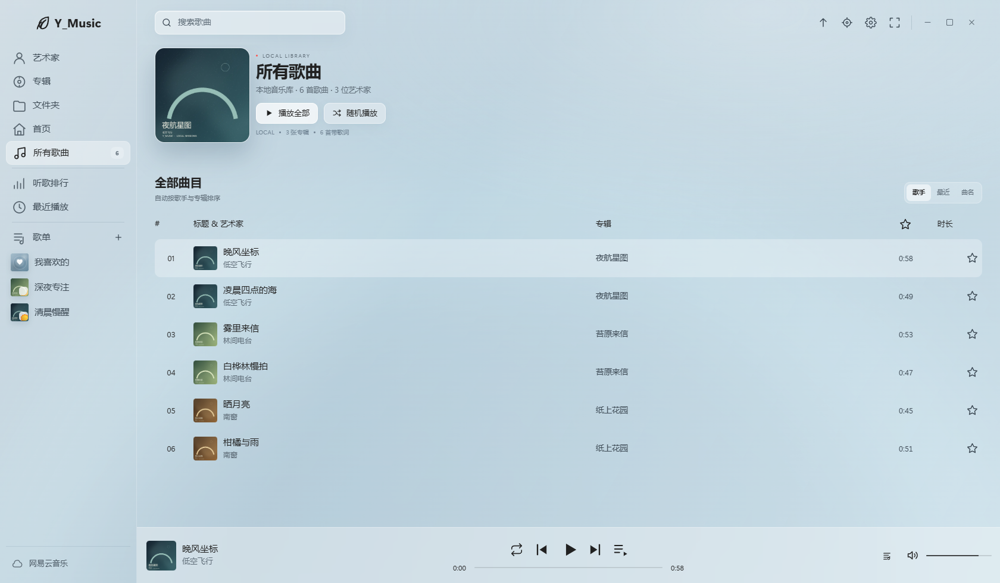
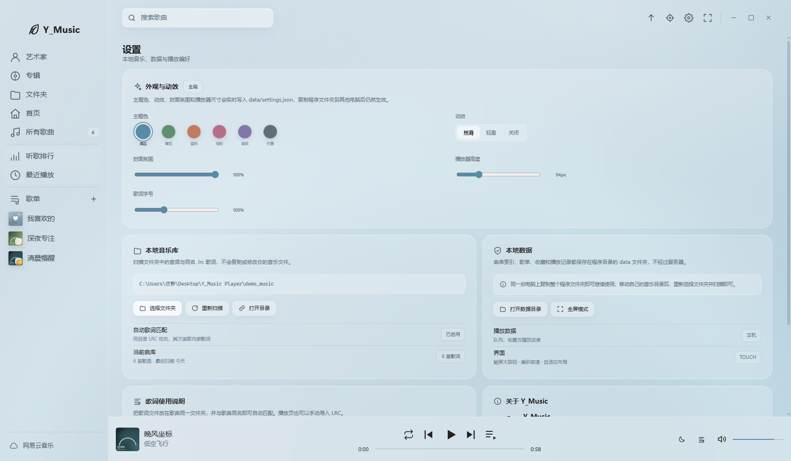

<div align="center">

# Y_Music

**本地优先 · 触摸友好 · 白板音乐空间**

A local-first, touch-friendly music player for interactive whiteboards.


</div>

Y_Music 是一个为**触摸白板、横屏展示和桌面大屏**设计的本地音乐播放器。它不依赖音乐服务器：扫描本地文件夹、读取音频标签与封面、自动匹配歌词，歌单、收藏和播放记录全部保存在程序自己的 `data/` 目录里。

界面结构参考 [Sylvakru](https://github.com/AfalpHy/sylvakru) 的浅色磨砂风格，全屏歌词动效参考 [Lyricify](https://github.com/WXRIW/Lyricify-App)。使用 Electron + 原生 Web Audio 实现，Windows 10 / 11 开箱即用。





## 为什么是 Y_Music

- **本地优先**：曲库、封面、歌词、歌单都在本机，断网也能完整使用。
- **为大屏和触摸设计**：更大的按钮、可调播放器高度、可调歌词字号、触屏手势。
- **歌单跟着文件夹走**：设置与歌单保存为普通 JSON，复制整个程序目录即可带到另一台电脑。
- **不只好看**：自动歌词、内嵌封面、睡眠定时器、全局主题、丝滑动效。
- **无账号体系**：不需要登录，不上传个人数据。

## 主要功能

### 本地音乐库

- 扫描 MP3 / FLAC / WAV / M4A / AAC / OGG / Opus。
- 读取标题、艺术家、专辑、音轨、年份、时长、码率、内嵌封面。
- 无内嵌封面时自动寻找同目录 `cover.jpg` / `folder.jpg`。
- 按艺术家、专辑、文件夹自动归类；标签缺失时使用文件名和文件夹名回退。
- 播放全部、随机播放、队列、单曲循环、列表循环、收藏。
- 「听歌排行」按本机播放次数统计，不联网。
- 支持 4K / 大屏自动缩放。

### 自动歌词

- 优先匹配歌曲同目录、同名的 `.lrc`，支持 `01 歌名.lrc` 等前缀。
- 没有同名歌词时读取内嵌歌词（ID3 USLT / LYRICS 等）。
- 支持 UTF-8、UTF-8 BOM、UTF-16、GB18030 / GBK 编码。
- 支持 `[mm:ss.xx]`、多时间标签、翻译行和 `[offset:]`。
- 全屏歌词采用 Lyricify 风格：当前行放大高亮、相邻行景深模糊、平滑逐行滚动、渐进填色与翻译行适配。
- 沉浸页可点击歌词跳转，可整体提前 / 延后 0.5 秒，可手动导入 / 替换 LRC。

### 可编辑歌单

- 新建、改名、写说明、选颜色与图标。
- 从曲库多选歌曲，随时增删。
- 只保存歌曲引用，不复制、不修改音频文件。
- 「我喜欢的」为内置歌单，同样保存在本地。

### 全局个性化

- 6 套主题色：海盐、青苔、蜜桃、樱粉、雾紫、石墨。
- 3 档动效：丝滑 / 轻盈 / 关闭。
- 可调封面氛围、播放器高度（76–150px）、歌词字号（80%–140%）。
- 设置实时写入 `data/settings.json`，所有页面同步生效。
- 主题、动效和播放器尺寸会随程序目录一起迁移。

### 触摸大屏增强

- 睡眠定时器：15 / 30 / 45 / 60 / 90 分钟后自动暂停，倒计时显示在播放器上。
- 播放器空白区或沉浸页左右滑动切换上一首 / 下一首。
- 页面切换、封面呼吸、环境背景漂浮等轻量动效。
- 主要按钮按触摸尺寸设计，手指可直接操作。

### 本地公告

启动播放器时会在左下角显示版本提示小窗，可点击「查看公告」阅读完整 Markdown；默认 **10 秒**后自动关闭。

公告完全本地化：

- `data/announcement.md`：公告正文，直接写 Markdown。
- `data/announcement.json`：开关、版本号、标题和自动关闭秒数。

```json
{
  "enabled": true,
  "version": "v1.4.0",
  "title": "Y_Music 版本提示",
  "file": "announcement.md",
  "autoCloseSeconds": 10
}
```

把 `enabled` 改为 `false` 即可关闭启动提示。修改后重启生效；也可以在「设置 → 本地数据 → 本地公告」再次查看。

### 网易云公开接口（可选）

- 支持公开曲库搜索与在线播放，搜索时批量补全封面和专辑信息。
- 在线播放受版权、会员和地区限制；无法获取播放地址时会明确提示，不影响本地播放。
- 在线歌曲不会写入本地曲库；在线歌词只在播放时读取。
- 这是一个非官方公开接口，可能随平台策略调整而失效。本地功能不依赖它。

## 快速开始

### 环境

- Windows 10 / 11
- 从源码运行需要 Node.js 20 或更高版本

### 从源码运行

从本仓库页面选择 **Code → Download ZIP**，或使用 Git 拉取源码，然后在项目根目录执行：

```bash
npm install
npm start
```

首次启动且没有曲库数据时，会自动载入 `demo_music` 中的 6 首示例歌曲和歌词。

也可以只打开窗口、不自动最大化：

```bash
npm run windowed
```

### 便携目录

如果目录已经包含 `node_modules`，可以直接双击：

```text
启动 Y_Music.cmd
```

程序是绿色便携的：把整个目录复制到另一台 Windows 电脑后仍可使用。若 `node_modules` 被删除，执行一次 `npm install` 即可恢复。

### 使用自己的音乐

1. 打开「设置 → 本地音乐库」。
2. 点击「选择文件夹」，选中音乐目录。
3. 等待扫描完成；封面、歌词和标签会自动建立索引。
4. 在「所有歌曲」「艺术家」「专辑」「文件夹」中浏览，或新建歌单。

> 首次扫描会写入 `data/`。请不要把个人的 `data/` 和 `node_modules/` 提交到 Git；仓库已经通过 `.gitignore` 排除它们。

## 数据与隐私

所有个人数据都在程序目录下的 `data/`：

```text
data/
├─ library.json       本地曲库索引
├─ sections.json      自定义歌单与收藏
├─ player.json        队列、收藏、最近播放、播放次数
├─ settings.json      曲库路径、主题、动效、播放器高度、音量
├─ announcement.md    启动公告正文
├─ announcement.json  公告开关、版本、标题、自动关闭秒数
├─ covers/            自动缓存的封面
└─ lyrics/            内嵌或手动导入的歌词
```

- 程序不收集、不上传个人数据。
- 在线搜索只会把关键词发送到网易云公开接口。
- 主题、动效、歌单、收藏和播放记录都是全局配置，不依赖浏览器缓存。
- 曲目使用稳定的元数据指纹 ID；移动音乐目录后重新选择文件夹并扫描，原歌单、收藏和播放记录仍能匹配。

**备份方式**：关闭程序后复制整个 `data/` 目录即可。恢复时把它放回程序目录。

## 快捷键

| 操作 | 方式 |
| --- | --- |
| 播放 / 暂停 | 底部播放键或 `Space` |
| 全屏 / 退出全屏 | 设置页按钮或 `F11` |
| 沉浸歌词 | 底部「歌词」或 `L` |
| 播放队列 | 底部队列按钮 |
| 静音 | 音量图标或 `M` |
| 上一首 / 下一首 | 底部按钮或 `Shift + ← / →` |
| 关闭弹层 / 返回 | `Esc` 或左上角返回 |
| 歌词跳转 | 点击任意同步歌词行 |
| 歌词微调 | 沉浸页「歌词提前 / 延后」 |
| 睡眠定时 | 播放器月亮图标 → 15–90 分钟 |
| 左右滑动切歌 | 播放器空白区或沉浸页（触屏） |
| 移动 / 最大化窗口 | 拖动顶部空白处 / 双击顶部 |

## 项目结构

```text
.
├─ app/
│  ├─ index.html       页面结构
│  ├─ styles.css       主题、布局与动效
│  └─ app.js           播放器、歌词、歌单、设置逻辑
├─ demo_music/         示例歌曲与 LRC
├─ data/               本地数据（不提交）
├─ main.js             Electron 主进程、扫描、IPC、网易云接口
├─ preload.js          contextBridge API
├─ preview.png         主界面预览
├─ customization.png   外观设置预览
├─ 启动 Y_Music.cmd    Windows 便携启动脚本
├─ LICENSE
└─ README.md
```

## 开发

```bash
# 普通启动
npm start

# 固定窗口启动
npm run windowed

# 打开开发者工具
npx electron . --devtools
```

界面代码位于 `app/`；曲库扫描、元数据、歌词缓存、歌单持久化和网易云请求位于 `main.js`。前后端通过 `preload.js` 暴露的 `window.musicAPI` 通信，渲染进程不开启 Node 集成。

技术栈：Electron、原生 HTML / CSS / JavaScript、Web Audio、`music-metadata`、`iconv-lite`。

## 已知限制

- APE、WMA、DSD 等 Chromium 无法直接解码的格式暂未纳入；可以转为 FLAC / MP3 后使用。
- 音乐目录被移动或清空时，程序会提示「歌曲文件缺失」，不会直接删除索引；重新扫描或选择文件夹即可恢复。
- 网易云公开接口可能因平台策略变化而失效，本地播放不受影响。
- 当前以源码 / 便携目录为主，尚未配置安装包生成流程。
- 示例音乐与封面由脚本合成，仅用于演示。

## 常见问题

**歌词不显示？**  
确认 `.lrc` 与歌曲同名并放在同一目录；也可以在沉浸页手动导入。乱码歌词建议另存为 UTF-8。

**换电脑后歌单还在，但歌曲显示缺失？**  
复制的是程序目录而不是音乐文件，或者音乐路径发生了变化。重新选择音乐文件夹并扫描即可；歌单引用会通过稳定 ID 恢复。

**在线歌曲无法播放？**  
受版权、会员或地区限制。这个是可选功能，不影响本地曲库。

**如何清空数据？**  
关闭程序后备份并删除 `data/`，下次启动会重新建立空库；删除前请确认不需要现有歌单和收藏。

## 致谢

- 界面结构与视觉参考：[Sylvakru](https://github.com/AfalpHy/sylvakru)
- 全屏歌词动效参考：[Lyricify-App](https://github.com/WXRIW/Lyricify-App)
- 音频元数据：[music-metadata](https://github.com/Borewit/music-metadata)
- 编码处理：[iconv-lite](https://github.com/ashtuchkin/iconv-lite)
- 桌面运行时：[Electron](https://www.electronjs.org/)

## License

本项目基于 [MIT License](LICENSE) 开源。

音乐、封面和歌词的版权归各自权利人所有。本项目不提供、不存储任何受版权保护的音乐资源；请使用自己拥有合法使用权的音频文件。网易云相关能力仅调用公开接口，与网易云音乐官方无关。

---

<div align="center">

**Y_Music** © 2026 夜静（YeJing-Neko）

[GitHub](https://github.com/YeJing-Neko)

如果这个项目对你有帮助，欢迎 Star。

</div>
